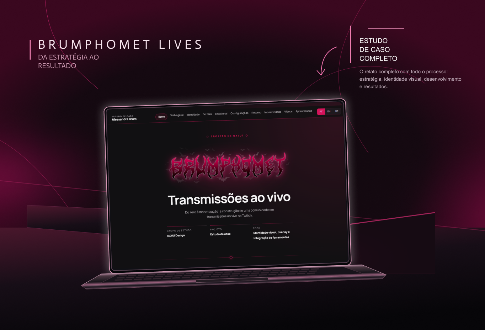

# estudo-de-caso-brumphomet-lives
Este projeto é a versão completa do meu estudo de caso "Do zero à monetização: a construção de uma comunidade em transmissões ao vivo na Twitch.
Construído em HTML, CSS, JavaScript. Otimizo meu trabalho com o auxílio de ferramentas como o ChatGPT e o Claude.

